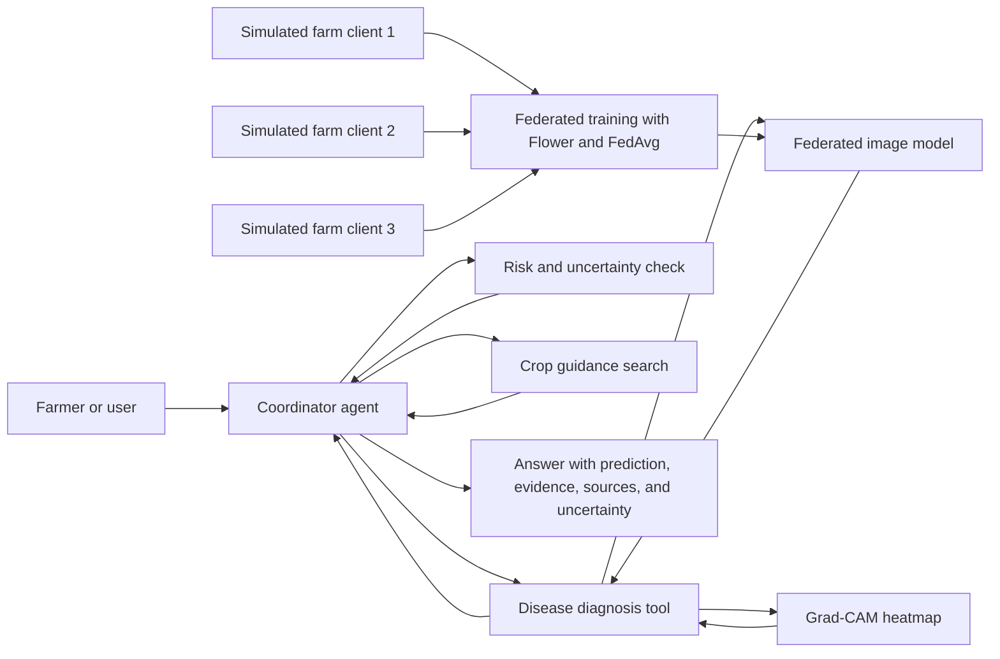

# Federated, Explainable Crop-Disease Advisor

## Project Summary

This project explores a crop-disease image classifier trained using federated learning, explains its predictions with visual heatmaps, and presents its results through a small multi-agent application.

A user uploads a leaf image and asks for help. The system predicts a likely disease, highlights image regions that influenced the prediction, retrieves relevant crop-care guidance, and gives a cautious answer with sources. The model is trained across simulated farm clients without pooling their training images.

**Important scope note:** The farms are simulated by partitioning public datasets. They are not real farms or independent data owners. The project keeps raw images local during federated training, but this alone does not guarantee privacy because model updates can still reveal information.

## Why Combine These Approaches?

The project has three components that solve different problems:

- **Federated learning (FL)** is a way to train a shared model across separate clients while keeping their raw training data local.
- **Explainable AI (XAI)** helps show what image regions influenced an individual prediction.
- **A multi-agent system** coordinates specialized functions to turn model outputs and sourced information into a useful response.

The main research work should be the model and its evaluation. The agent is the user-facing demonstration; it should not obscure whether the model actually performs well.

## Research Question

Can a federated crop-disease model perform usefully across different data sources, and can a coordinating agent communicate its predictions, visual explanations, and uncertainty responsibly?

## System Architecture

The diagram shows both training and use of the application. During training, simulated clients collaborate to update the model. During use, the coordinator calls tools that access the trained model and trusted crop-care information.

## Project Sections and Methods

### 1. Data

Start with two public image datasets:

- **PlantVillage:** [GitHub repository](https://github.com/spMohanty/PlantVillage-Dataset). Use it to train the first classifier and create simulated client datasets. Its images are relatively clean, which makes it a practical starting point.
- **PlantDoc:** [GitHub repository](https://github.com/pratikkayal/PlantDoc-Dataset). Use it as a separate test set to examine performance on more varied images.

Before training, inspect the labels, image quality, and dataset terms. Map labels between the datasets carefully and test only on disease classes that match reliably. Record the mapping and any classes excluded from the comparison.

Do not mix both datasets and then make a random train/test split. Testing on a separate source gives a more useful check of generalization. Check each dataset's license and terms before using or redistributing it.

### 2. Image Classifier and Transfer Learning

Begin with a pretrained image model such as **ResNet-18**, then fine-tune it on the crop-disease images. Transfer learning starts from a model that already recognizes general image features, which is usually more manageable than training a deep network from scratch.

First train and test a centralized baseline. This confirms that image loading, labels, and model training are working before introducing federated learning. Reuse the same model architecture for all training comparisons.

### 3. Federated Learning with Flower and FedAvg

Use [Flower](https://flower.ai/) to simulate multiple training clients and **FedAvg**, a common federated averaging method.

In centralized training, images are collected in one place. In federated training, each client trains a copy of the model using its own images and sends model updates to a coordinating server. The server averages the updates and sends the shared model back to clients. Raw training images are not sent to the server.

For this project, clients can run on one computer. Divide PlantVillage into three or more client datasets to simulate separate farms. Compare:

- **Centralized baseline:** all training images are used together. This is a performance reference, but it does not keep client datasets separate.
- **Local-only baseline:** each client trains using only its own images and does not share updates. This shows the effect of limited local data.
- **Federated model:** clients train collaboratively using FedAvg.

Test both balanced and **non-IID** client splits. IID means clients have roughly similar data distributions. Non-IID means clients differ, for example in which crops or diseases are common. Non-IID data is often more realistic and more challenging for federated training.

### 4. Explainability with Grad-CAM

Use **Grad-CAM** to overlay a heatmap on the leaf image. It estimates which image regions influenced the model's selected class.

Show the original image, predicted class, confidence score, and heatmap together. A heatmap is evidence about what influenced the model; it is not proof that the model focused on the correct biological symptom.

For an initial evaluation, inspect heatmaps for correct and incorrect predictions. Also test whether hiding highlighted regions changes the prediction. This is a useful diagnostic check, but without expert-annotated symptom regions it does not establish that the heatmaps are biologically correct.

### 5. Multi-Agent Application

Use a **supervisor-specialist** pattern: the user speaks to one coordinator, which calls focused tools and combines their outputs. In the first version, specialists can be functions or tools rather than separate autonomous AI models. This is simpler to build and easier to evaluate.

- **Disease diagnosis tool:** calls the image model and returns the predicted class, confidence, and Grad-CAM heatmap.
- **Risk and uncertainty check:** checks confidence and known model limitations. Keep it rule-based in the first version; weather or regional context can be a later extension.
- **Crop guidance search:** retrieves advice from a small collection of trusted agricultural sources and returns the source references.
- **Coordinator agent:** explains the result in plain language, includes sources, and communicates uncertainty.

The coordinator must not invent a diagnosis or override the classifier without evidence. For a low-confidence result, it should say that the image is inconclusive and suggest a clearer image or advice from an agricultural expert. Guidance should be attributed to its source and not presented as guaranteed treatment advice.

### 6. Evaluation

Evaluate the model, explanations, and agent separately so it is clear what each part contributes.

**Model performance**

- Compare centralized, local-only, and federated models.
- Compare balanced and non-IID client splits.
- Report accuracy, macro F1, and per-class recall. Macro F1 gives each class equal weight, helping reveal poor performance on less common diseases.
- Evaluate on PlantDoc for disease classes that map reliably to PlantVillage labels.

**Explanation behavior**

- Inspect heatmaps on correct and incorrect predictions.
- Run the highlighted-region masking check.
- State the limitation that there are no expert-labeled symptom regions for fully validating the heatmaps.

**Agent behavior**

- Check whether the response reports the model prediction and confidence accurately.
- Check that crop-care advice is supported by a retrieved source.
- Check that the coordinator communicates low confidence and avoids unsupported claims.

A successful result does not require federated learning to outperform centralized training. The project can still be valuable by showing where federated training works, where it struggles, and how the application should communicate those limits.

## Suggested Build Order

1. **Inspect the data:** check licenses, labels, class overlap, and sample images.
2. **Train a centralized baseline:** confirm the data pipeline and classifier work.
3. **Add federated training:** use Flower and FedAvg; create balanced and non-IID client splits.
4. **Add Grad-CAM:** display heatmaps and run basic explanation checks.
5. **Build the agent flow:** connect the diagnosis tool, a small sourced guidance collection, and the coordinator.
6. **Evaluate and prepare the demo:** show examples where the prediction is correct, incorrect, and uncertain.

## Core Scope and Optional Extensions

**Core version:** one crop-disease image classifier, simulated clients, FedAvg, Grad-CAM, PlantDoc external testing, and a coordinator that provides sourced guidance.

**Optional extensions:** weather-aware risk assessment, stronger privacy techniques, more client-split strategies, or a user study. Add these only after the core model and evaluation work.

## Talking Points for a Colleague Discussion

- The project studies whether federated training can work across clients with different data, not whether it is automatically better than centralized training.
- The explanation visualizes image regions that influenced the model; it does not prove the prediction is correct.
- The agent coordinates the model and trusted information. It is not itself the disease-diagnosis model.
- Public datasets simulate separate farms, so results should not be described as a real deployment across farms.
- The final demo should show uncertainty and failure cases as well as successful predictions.
