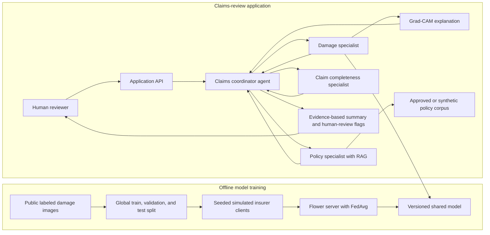

# Implementation Plan: Federated, Explainable Vehicle-Damage Claims Assistant

## 1. Project Definition

### Working title

**Federated, Explainable Vehicle-Damage Triage with a Policy-Grounded Multi-Agent Assistant**

### Short description

Build a prototype that helps a human insurance claims reviewer organize a vehicle-damage claim. A deep-learning model identifies visible damage categories from an image. Federated learning (FL) trains a shared model across simulated insurer clients without pooling their raw training images. Explainable AI (XAI) highlights image regions that influenced a prediction. A policy assistant retrieves relevant clauses from a controlled document collection and cites them. Specialist agents return structured findings to a coordinator, which summarizes evidence and uncertainty for a human reviewer.

The system is **decision support only**. It must not approve or deny claims, determine payment, or make legal conclusions.

### Core research question

How does federated training compare with centralized and local-only training for vehicle-damage classification when simulated insurers have different data distributions, and can an assistant communicate model evidence and policy sources without overstating either?

### Project objectives

- Train a deep image model for a clearly defined, labeled vehicle-damage task.
- Compare centralized, local-only, and federated training under IID and non-IID client splits.
- Explain image predictions and test the limits of those explanations.
- Build policy retrieval with citations and an agent workflow that communicates uncertainty.
- Produce a reproducible, tested application and report its limitations.

### Explicit non-goals

- Predicting repair cost, legal liability, fraud, or claim approval.
- Claiming real-world privacy protection from simulated FL alone.
- Using real personal, policyholder, or claim data.
- Claiming Grad-CAM proves that the model used valid damage evidence.

## 2. Overall Architecture



The training and runtime paths are separate. Training creates a versioned model; runtime tools use that model and the policy corpus. In the local simulation, clients may run on one computer, but their data partitions and training loops should remain logically separate.

## 3. Data Plan: Access, Generation, and Use

### 3.1 Damage images and labels

**Candidate source:** The original [CarDD-Share repository](https://github.com/CarDD-Share/CarDD) is currently not accessible. The available references are the [CarDD-USTC project site](https://cardd-ustc.github.io/) and its [GitHub repository](https://github.com/CarDD-USTC/CarDD-USTC.github.io). Review the project's dataset and download instructions, paper, access requirements, and license before use. As a fallback, search [Kaggle vehicle-damage datasets](https://www.kaggle.com/search?q=car+damage+detection), but evaluate each dataset independently.

CarDD is a promising source for the **vehicle-damage vision component** and may support model training and simulated FL. It does not provide the policy knowledge base or claim-workflow examples: create a separate synthetic policy pack for retrieval and generate synthetic claim records for completeness checks.

Before adopting a dataset, verify:

- You can actually access and download it.
- Its license or terms allow your intended research and demo use.
- It has labels suitable for your selected task.
- It has enough images per class to split into train, validation, test, and simulated clients.
- Its annotations can be parsed consistently and the class definitions are understandable.

Choose the vision task only after inspecting the downloaded annotations:

- If labels apply to whole images, use image classification. Use multi-class classification when each image has one class, or multi-label classification when an image can have several image-level labels.
- If annotations include damage categories and bounding boxes, object detection is the more direct task because it both locates and classifies damage. A simpler alternative is to derive image-level multi-label targets from the boxes, but this discards location information and must be documented.
- Do not assume the dataset has severity labels. Predict only targets actually annotated; do not infer severity, repair cost, liability, or coverage from damage categories.

Before locking the architecture, verify the actual archive, annotation schema, and download terms. If the expected annotations are unavailable, choose a task supported by the data or select another dataset before implementing the model.

**Data handling:** keep downloaded images outside source control unless the license permits redistribution. Commit only a data card, download/setup instructions, class mapping, split-generation code, and small synthetic test fixtures. Record source, version, license, checksums, and preprocessing in a manifest.

### 3.2 Policy documents for retrieval

For the first implementation, create a small **fictional policy pack** yourself. This avoids access and redistribution problems and gives you known answers for testing retrieval. Clearly mark every document `SYNTHETIC - NOT AN INSURANCE CONTRACT`; do not copy real policy wording. Create one base policy and two short variants with deliberately different terms, such as different deductibles or required documents, so the tests can check whether retrieval selects the correct policy and clause.

For research context or a later extension, look at [NAIC auto insurance consumer resources](https://content.naic.org/consumer/auto-insurance.htm) for terminology and general explanations. These are consumer resources, not a substitute for an actual policy contract. You can also look for public forms and consumer guides through your state Department of Insurance and search [SERFF Filing Access](https://filingaccess.serff.com/sfa/home/), where availability depends on the filing and jurisdiction. Check access and reuse terms before downloading, indexing, quoting, or redistributing any real form. Publicly viewable does not automatically mean reusable.

For each real source you do use, keep a manifest with source URL, document title, insurer or regulator, jurisdiction, publication/effective date, retrieval date, and license/terms. Retain the original source separately from normalized text; do not commit restricted PDFs or policyholder documents.

**Fictional policy structure:** write sections for policy period, covered damage, exclusions, deductible, duties after an incident, and documents requested for review. Give every clause a stable ID and keep wording internally consistent. For example:

```json
{
	"policy_id": "SYN-AUTO-A",
	"version": "1.0",
	"status": "synthetic_demo_only",
	"jurisdiction": "fictional",
	"required_documents": ["incident_form", "vehicle_photo", "repair_estimate"],
	"clauses": [
		{
			"clause_id": "SYN-AUTO-A-CLAIM-03",
			"title": "Documents for initial review",
			"text": "For this fictional demo policy, the reviewer requires an incident form, clear vehicle photographs, and a repair estimate for initial claim review."
		}
	]
}
```

Do not present the example wording as real insurance language or a real coverage rule.

**How to prepare the retrieval corpus:** convert permitted documents to text, preserve headings and clause boundaries, and create one chunk per clause or short related section. Attach `policy_id`, `clause_id`, `title`, `version`, `source`, and jurisdiction/status metadata to each chunk. Avoid chunks that mix unrelated clauses. Store normalized chunks as JSONL or another structured format and build the search index from them; the index is derived data, not the source of truth.

### 3.3 Synthetic claim workflow records

Generate synthetic claim records with a small script and fixed random seed rather than using real claims or asking an LLM to invent unreviewed ground truth. Use fictional IDs and values only. Keep these workflow examples separate from image-model training unless you later define a valid, licensed supervised task.

Each record should identify its synthetic policy and scenario, provide only the fields needed for the workflow, and include a hand-authored expected outcome for testing. Example:

```json
{
	"claim_id": "SYN-0001",
	"policy_id": "SYN-AUTO-A",
	"scenario": "missing_repair_estimate",
	"incident_date": "2026-01-15",
	"damage_categories_reported": ["scratch"],
	"documents_submitted": ["incident_form", "vehicle_photo"],
	"documents_expected_by_synthetic_policy": ["incident_form", "vehicle_photo", "repair_estimate"],
	"expected_missing_documents": ["repair_estimate"],
	"expected_evidence_clause_ids": ["SYN-AUTO-A-CLAIM-03"],
	"expected_action": "request_missing_document"
}
```

Generate a small scenario set that covers at least: all requested documents present; a required document missing; an optional document missing; conflicting incident details; an unclear damage image; an unsupported policy question; and a question whose answer is ambiguous in the synthetic policy. Label each expected outcome and supporting clause yourself. For sources on real-world process vocabulary, consult state Department of Insurance consumer claim guides, but treat them as general context, not universal requirements. These scenarios test software behavior; they are not ground truth for real claim decisions.

### 3.4 Evaluation questions and expected evidence

Write a small hand-reviewed test set for policy retrieval. Each example should include the policy ID, question, expected clause IDs, and whether the answer is supported, unsupported, or ambiguous. Include similar questions for different policy variants, plus unanswerable questions to test whether the system declines to guess. Keep expected answers and evidence in a structured file so automated tests can load them.

Example: “Does the synthetic policy require a repair estimate?” Expected evidence: the exact clause ID in the fictional policy. Do not use generated answers as ground truth without reviewing them yourself.

### 3.5 Simulated insurer clients

Create clients from the training portion only. First create a global train/validation/test split; only then divide training examples among clients. This prevents test examples from entering client training. If metadata identifies multiple photos of the same vehicle or event, keep related examples in one split. If that metadata is absent, check exact and near-duplicate images before splitting.

Create and save two reproducible partitions:

- **IID-like partition:** randomly distribute training examples so each client has roughly similar class proportions.
- **Non-IID partition:** use a seeded class-skew method, such as a Dirichlet distribution with a documented concentration parameter, or deliberately assign different class proportions to clients. Small concentration values create stronger class skew. Record client sizes and per-class counts.

These are simulations of cross-silo FL, not evidence that real insurers participated. Ensure every class has enough examples for meaningful evaluation; if not, reduce the class set or use fewer clients.

## 4. Recommended Technology and Repository Shape

Choose tools that make each component easy to inspect and reproduce:

- **Python and PyTorch/torchvision:** image model and training code.
- **Flower:** federated simulation and client/server orchestration.
- **Captum or a compatible Grad-CAM implementation:** image explanation.
- **FastAPI:** typed application API and tool endpoints.
- **A small vector index such as FAISS or Chroma:** local policy retrieval during development.
- **Streamlit:** a simple demo UI; a more polished frontend can come later.
- **pytest and Docker:** automated tests and repeatable execution.

Keep training and application components separate. A possible structure:

```text
data/
	README.md                 # How to obtain data; do not commit restricted images
	manifests/                # Source, license, class map, split metadata
src/
	data/                     # Annotation parsing, validation, partition generation
	models/                   # Model definition and centralized training
	federated/                # Flower client, server, strategies, simulation
	explainability/           # Grad-CAM and explanation evaluation
	retrieval/                # Document parsing, indexing, search, citations
	agents/                   # Specialist tools, schemas, coordinator
	api/                      # FastAPI routes and request/response models
tests/
reports/                    # Metrics, plots, model cards, experiment notes
```

Use notebooks for exploration if helpful, but move stable logic into importable modules and scripts so the experiments can be rerun.

## 5. Step-by-Step Implementation

### Step 0: Set a provisional task and acceptance criteria

**Propose, but do not yet lock:** image-level classification as the simplest path; switch to object detection if the verified data provides useful damage bounding boxes and you have time to implement and evaluate a detector. Do not include severity unless the data explicitly labels it.

**Write down:** the provisional target, research question, intended user, what the system will not do, and initial acceptance criteria. Example: all three training baselines run on the same fixed split; the demo returns a damage result, confidence, explanation or location, and policy citations; uncertain cases are flagged. Confirm the final task after the Step 1 data audit.

**Exit check:** a one-page task specification and data feasibility checklist exist before substantial coding begins.

### Step 1: Verify and audit the data

1. Obtain the candidate dataset using its documented access process.
2. Record license/terms, source, version, download date, and class definitions.
3. Parse annotations and create a manifest with image path, labels, bounding boxes, and annotation format where available. Verify whether labels apply to the whole image or to individual damage instances.
4. Generate class counts, image dimensions, missing-file counts, and a contact sheet for visual inspection.
5. Check corrupted files, duplicate images, label errors, and class imbalance.
6. Choose the task from the actual annotations: image classification for image-level labels, or object detection when category-labeled boxes are available and useful. If converting boxes into image-level labels for a simpler classifier, record that location information is discarded. Do not infer severity without explicit labels.

**Deliverable:** a data audit report and a reproducible dataset-preparation script. The report must identify the target labels, annotation type, class counts, access/license status, and chosen task. If CarDD access or annotations do not support the intended task, revise the task or dataset now. Do not start FL until a centralized baseline can load the data reliably.

### Step 2: Build leakage-safe splits and client partitions

1. Split examples into training, validation, and test sets before generating clients. Use grouped splitting when several images come from the same vehicle or incident.
2. Apply the same fixed test set to every training approach.
3. Generate seeded IID-like and non-IID client partitions from the training set only.
4. Save split IDs and client assignments in metadata files; do not rely on implicit directory ordering.
5. Report each client's sample count and class proportions.

**Validation:** assert that train/validation/test IDs do not overlap, client partitions do not overlap each other, and their union equals the training set. Check that no test images appear in client data.

### Step 3: Establish a centralized deep-learning baseline

Select the baseline to match Step 1's annotation audit:

- **Image-level classification:** use transfer learning with a pretrained model such as ResNet-18. Replace the final layer to match the selected label setup. For multi-label data, use sigmoid outputs and a multi-label loss; for single-label data, use softmax-style class probabilities and a multi-class loss.
- **Bounding-box object detection:** use a pretrained detector, such as a torchvision Faster R-CNN model, and adapt its classes and box targets to the dataset. This task is more involved than classification, so first prove the centralized detector trains and evaluates correctly before adding FL.

Keep the model definition, preprocessing, and label mapping identical across centralized, local-only, and federated comparisons. Do not choose a classifier simply because it is easier if the project's stated goal is to locate damage and the data provides box annotations.

1. Resize and normalize images consistently with the pretrained model.
2. Apply moderate training-only augmentation, such as horizontal flips and small color changes; do not augment validation or test data randomly.
3. Train first with a frozen feature extractor, then optionally fine-tune later layers.
4. Save configuration, random seeds, metrics, class mapping, and model checkpoint.
5. Tune thresholds or select checkpoints using validation data only.

**Metrics:** for classification, use macro F1 and per-class precision/recall; include a confusion matrix for single-label tasks and per-class precision-recall results for multi-label tasks. For detection, report mean average precision at IoU 0.5 and, if practical, across IoU 0.5:0.95, with per-class results. Include accuracy only as a secondary metric when classes are imbalanced.

**Exit check:** a clean baseline trains, can be reloaded, and produces metrics on the untouched test set.

### Step 4: Implement federated training

Use Flower to simulate clients locally and FedAvg as the initial aggregation strategy. A client receives the current model, trains on its local partition for a defined number of local epochs, and returns model updates and example counts. The server aggregates updates and distributes the next global model.

Implement three comparisons:

- **Centralized:** train on the combined training data.
- **Local-only:** train one independent model per client with no aggregation.
- **Federated:** train collaboratively using FedAvg.

For a fair comparison, keep the architecture, data preprocessing, train/validation/test IDs, and main optimization settings consistent. Track rounds, local epochs, client participation, runtime, and communication volume where practical. Run more than one seed if compute allows.

Test both IID-like and non-IID partitions. Report overall test metrics and, where meaningful, performance by client distribution. Do not treat the held-out global test set as a client training set.

**Privacy caveat:** this is a software simulation on one machine. It demonstrates the FL training workflow and data partitioning, not protection against model-update leakage. Differential privacy or secure aggregation can be a stretch goal, not an implied property of FedAvg.

**Exit check:** the three baselines run on the same data protocol and generate a comparable results table.

### Step 5: Add confidence and abstention behavior

Calibrate confidence using the validation set only. For example, choose a threshold below which the interface says “uncertain” and requests human review rather than presenting a confident-sounding label. Do not tune this threshold on the test set.

If images can contain multiple damage classes, define per-class thresholds and clearly indicate that scores are not necessarily calibrated probabilities unless calibration is evaluated. Track a calibration metric such as expected calibration error or Brier score where appropriate.

**Exit check:** low-confidence and unsupported inputs produce a cautious result rather than a definitive diagnosis.

### Step 6: Add image explanations

For an image classifier, generate Grad-CAM for the predicted class (or selected class in a multi-label task). Display the original image, prediction, confidence, and heatmap. Use the model's actual target score when generating each heatmap.

For an object detector, explanation for a particular detected box is more involved. If implementing it, generate an attribution for the selected detection/class score and display it alongside the predicted box. If that is beyond scope, make detector-specific Grad-CAM a stretch goal; do not call a predicted bounding box itself an XAI heatmap. Ground-truth boxes can help evaluate localization, but they do not prove that an explanation is faithful.

Evaluate explanations as diagnostics, not ground truth:

- Inspect examples across classes and include correct and incorrect predictions.
- If the dataset supplies damage bounding boxes, measure whether the strongest activation falls inside an annotated box. Treat this as a rough localization check, not proof of causal faithfulness.
- Run an occlusion or deletion check to see whether hiding highlighted areas changes the target score.
- Document failure cases, such as attention to backgrounds, reflections, or vehicle logos.

**Exit check:** heatmaps are reproducible and the report describes their limitations.

### Step 7: Build the policy knowledge base and RAG evaluation

1. Start with the fictional policy pack so you can test without real policy access. Keep any later public sources in a separate collection with provenance and reuse terms.
2. Normalize each policy into structured records. Preserve the original document and create clause-level text records with `policy_id`, `clause_id`, `title`, `version`, `source`, and `text`. Store required-document rules separately as structured data for deterministic completeness checks.
3. Build a small ingestion script that reads those records, validates required fields and unique IDs, and writes normalized JSONL. Make ingestion repeatable so the search index can always be rebuilt.
4. Begin retrieval with a simple keyword baseline such as BM25. Then add an embedding-based index using FAISS or Chroma and compare results on the same question set. Avoid adding reranking until you have a measured retrieval problem it could solve.
5. For each test question, record the target policy, expected clause IDs, and answerability (`supported`, `ambiguous`, or `unsupported`). Include similar questions across policy variants so a wrong-policy citation is detectable.
6. Retrieve the top clauses and return their IDs, titles, versions, and text as citation metadata. The response generator must answer only from retrieved evidence; if no clause supports an answer, it should state that the policy corpus does not establish it.
7. Test retrieval and answer behavior separately: first whether the right clause is retrieved, then whether the answer accurately represents that clause and cites it.

**Metrics:** retrieval Recall@k or MRR for expected clauses, citation correctness, and a small rubric checking whether generated statements are supported by retrieved text. Human review is appropriate for a small student evaluation.

**Exit check:** the system can answer a supported question with the correct clause citation and abstain when the corpus has no answer.

### Step 8: Implement the multi-agent workflow

Use a supervisor-specialist architecture with constrained inputs and outputs. A first version can implement specialists as tool-calling functions; the advanced version can give each specialist a narrow prompt and allow the coordinator to delegate. Do not give agents unrestricted web access or permission to make claim decisions.

- **Damage specialist:** calls the trained model and XAI function; returns labels, confidence, heatmap location, model version, and warnings.
- **Policy specialist:** retrieves clauses; returns concise excerpts, section IDs, source/version, and whether evidence is sufficient.
- **Completeness specialist:** deterministically compares synthetic claim fields with the selected policy's structured required-document list and reports missing items. It reports missing fields, not coverage decisions; do not ask an LLM to infer mandatory documents from arbitrary policy prose in the first version.
- **Coordinator:** asks for missing context when needed, calls relevant specialists, distinguishes model predictions from policy text, flags disagreements, and produces a human-review summary.

Use structured output schemas and test each specialist independently. The final response should separate: observed image/model output, retrieved policy evidence, missing information, uncertainty, and reviewer action. Never let the coordinator invent a source, silently change a model prediction, or turn a damage category into a payout recommendation.

**Exit check:** a fixed set of test scenarios produces valid structured outputs, citations, and abstentions.

### Step 9: Provide an API and demo

Expose a small FastAPI workflow, for example:

- `POST /claims/analyze` accepts an image and optional synthetic claim fields.
- The response includes model version, predicted categories and confidence, predicted boxes when using a detector, an explanation image when implemented, retrieved citations, missing-information flags, and a human-review note.
- Validate file type and size, handle malformed inputs, and avoid logging uploaded image contents.

Build a simple Streamlit interface with an image upload and distinct sections for classification or detection output, Grad-CAM when available, policy sources, missing data, and uncertainty. Label synthetic policy documents clearly. Add Docker and setup instructions after the local workflow is stable.

### Step 10: Test the full system and document it

Create tests at several levels:

- **Data tests:** annotation parser, class mapping, split disjointness, and client partition integrity.
- **Model tests:** checkpoint load, output shape, invalid image handling, and deterministic inference where configured.
- **FL tests:** a small smoke run confirms clients train and the server aggregates.
- **RAG tests:** expected clause retrieval, citation metadata, and no-answer behavior.
- **Agent tests:** specialist output validation, tool failure handling, uncertainty communication, and no claim-decision language.
- **API tests:** valid request, invalid file, missing optional context, and model failure.

Write a README with setup commands, data access instructions, license notes, how to reproduce experiments, sample results, and limitations. Do not include restricted datasets, real claim records, API keys, or private policy documents in source control.

## 6. Evaluation Plan

| Component | Primary checks | Reported evidence |
|---|---|---|
| Damage model | Classification: macro F1 and per-class precision/recall. Detection: mAP at IoU 0.5 and, if practical, mAP across IoU 0.5:0.95. | Results by class, training method, and client split; use metrics matching the verified annotation type |
| Federated learning | Centralized vs local-only vs FedAvg; IID-like vs non-IID | Metrics, seeds, rounds, client sizes, and runtime/communication notes |
| XAI | Human inspection, annotation overlap if boxes exist, occlusion/deletion check | Example successes and failures; explicit caveats |
| Policy RAG | Retrieval Recall@k/MRR, citation correctness, supported/unsupported questions | Test questions, expected clauses, measured retrieval outcomes |
| Agent workflow | Correct tool use, structured output, uncertainty and abstention | Scenario-based test results and failure analysis |
| Application | API validation, error handling, reproducible run | Automated test results and demo instructions |

Do not claim the federated model is better merely because it is federated. A meaningful result may be that FedAvg approaches the centralized baseline on IID data but loses performance under class-skewed clients. Report observed results, not the results you hoped to get.

## 7. Suggested Milestones

| Milestone | Work completed | Exit condition |
|---|---|---|
| **M1: Feasibility** | Select dataset, confirm access and license, inspect annotations, choose task | Enough valid labeled data exists for a baseline and client split |
| **M2: Central baseline** | Data pipeline, transfer-learning classifier or detector as justified by annotations, test metrics | Reproducible centralized result and saved model |
| **M3: Federated experiment** | Client partitions, Flower/FedAvg, local-only and centralized comparisons | Comparable results for IID-like and non-IID conditions |
| **M4: XAI** | Confidence handling, Grad-CAM or detector explanation if feasible, localization/explanation checks | Demo shows evidence and limitations for sample predictions or detections |
| **M5: RAG and agents** | Policy corpus, evaluation questions, specialists, coordinator | Supported answers cite clauses; unsupported questions abstain |
| **M6: Product and report** | API, UI, tests, Docker, README, final analysis | Another person can run the demo and reproduce the main experiment |

Do not start M2 until M1 proves the data is accessible and labeled appropriately. If the dataset fails the feasibility check, choose a different dataset or reduce the task before building the rest of the system.

## 8. Final Deliverables

- Reproducible source code for centralized and federated training.
- Dataset acquisition instructions, data manifest, class mapping, and partition-generation scripts.
- Experiment configuration and results comparing the three training baselines.
- Saved model checkpoint and classification heatmaps or detection examples, subject to the dataset license.
- Policy corpus with source/version metadata and a hand-reviewed RAG evaluation set.
- Coordinator and specialist workflow with tests and a human-review boundary.
- API/demo, README, model card, and concise final report.

## 9. Risks and Scope Controls

- **Data access and task-fit risk:** the CarDD link, download instructions, annotation types, license, and class balance must be verified before committing. CarDD is only for the vision component; policy documents and claim-workflow examples are separate inputs. Do not design the project around inaccessible data or assume it includes image-level labels, boxes, or severity labels without checking.
- **Label risk:** image damage categories are not the same as severity, cost, liability, or coverage. Do not infer those targets without labeled data and a valid evaluation design.
- **Privacy risk:** simulated FL keeps partitions separate in code but does not establish a privacy guarantee.
- **Explanation risk:** Grad-CAM is an approximate visualization and may highlight irrelevant pixels.
- **RAG risk:** retrieval can find the wrong clause or omit an exception. Cite exact sections, test ambiguous cases, and keep a reviewer in the loop.
- **Agent risk:** multiple LLM agents can add cost and unpredictable behavior. Begin with bounded specialist tools and add LLM delegation only if it solves a measured problem.
- **Scope risk:** FL, image modeling, XAI, RAG, agents, and a UI are each substantial. A valid first release is centralized image model + FL comparisons + Grad-CAM. Add the policy assistant after those results are reproducible.

## 10. Recommended First Actions

1. Open the CarDD project site and repository; confirm whether the dataset itself is downloadable, what access steps are required, and which license/terms apply.
2. Create a small data-audit script that prints class counts, displays sample images and annotations, and confirms whether labels are image-level or instance-level boxes.
3. Choose classification or object detection based on those verified annotations; exclude severity unless explicitly labeled.
4. Keep the policy corpus and synthetic claim records as separate data sources for RAG and workflow testing.
5. Write the leakage-safe data split and synthetic-client plan before training.
6. Train a small centralized baseline and use its results to confirm that the selected task is feasible.

The most important early decision is dataset feasibility. Once the labels and data terms are verified, the rest of the plan can be implemented in measurable stages rather than guessed up front.

## 11. Learning Resources and Study Order

Use the subscriptions just before implementing each part. Course catalogs change, so search Pluralsight and O'Reilly by the topics below rather than relying on a course title that may have moved. Avoid watching several courses on the same topic before building; aim to finish each stage with a working project artifact.

### Stage A: Python and machine-learning foundations

- **Pluralsight search topics:** Python fundamentals, data handling with Python, classification, train/validation/test splits, and model evaluation.
- **O'Reilly book:** *Hands-On Machine Learning with Scikit-Learn, Keras, and TensorFlow* by Aurélien Géron. Focus on classification, evaluation, and convolutional neural networks. It uses a different framework from this plan, but the modeling and evaluation concepts transfer; implement the project with PyTorch if that is the selected stack.
- **Build checkpoint:** complete the CarDD access and annotation audit, then produce a reproducible data manifest and a leakage-safe split. Do not start model training until this checkpoint is met.

### Stage B: Deep learning and computer vision

- **Pluralsight search topics:** PyTorch fundamentals, image classification, transfer learning, computer vision, and object detection. Choose the detection material only if the verified dataset includes useful bounding-box annotations and you decide to use them.
- **O'Reilly book:** *Deep Learning with PyTorch, Second Edition* by Eli Stevens, Luca Antiga, and Thomas Viehmann. Use it as a reference for tensors, training loops, convolutional models, and transfer learning.
- **Free reference:** [PyTorch Tutorials](https://pytorch.org/tutorials/).
- **Build checkpoint:** train a centralized baseline matching the actual annotation type: classifier for image-level labels or detector for category-labeled boxes. Save its configuration and evaluation results.

### Stage C: Federated learning

- **Free practical reference:** [Flower documentation and tutorials](https://flower.ai/docs/framework/). Start with local simulation, clients, server orchestration, and FedAvg.
- **Pluralsight/O'Reilly search topics:** federated learning, FedAvg, cross-silo learning, distributed model training, non-IID data, and privacy-preserving ML. FL-specific catalog material may be limited, so use Flower's tutorials as the hands-on guide.
- **Build checkpoint:** run centralized, local-only, and FedAvg comparisons with the same train/test protocol; then repeat on balanced and non-IID client partitions. Record the fact that simulated FL alone does not guarantee privacy.

### Stage D: Explainability

- **Free book:** Christoph Molnar's [Interpretable Machine Learning](https://christophm.github.io/interpretable-ml-book/). Focus on feature attribution and the limits of explanation methods.
- **Free implementation reference:** [Captum tutorials](https://captum.ai/tutorials/), including image attribution methods compatible with PyTorch.
- **Pluralsight search topics:** explainable AI, model interpretability, feature attribution, Grad-CAM, and SHAP. Use image-focused material for the damage model; SHAP is more appropriate if a separate tabular model is later added.
- **Build checkpoint:** show explanations for correct and incorrect examples and document what a heatmap does and does not establish. For object detection, detector-specific attribution can remain an extension if it is beyond scope.

### Stage E: RAG and agent tools

- **O'Reilly books:** *AI Engineering: Building Applications with Foundation Models* by Chip Huyen for application design and evaluation; *Hands-On Large Language Models* by Jay Alammar and Maarten Grootendorst for LLM and retrieval concepts. Read selected sections relevant to retrieval, grounding, evaluation, and tool use rather than treating either book as a prerequisite to coding.
- **Pluralsight search topics:** retrieval-augmented generation (RAG), embeddings, vector search, retrieval evaluation, citations, structured output, and LLM tool calling.
- **Build checkpoint:** create the policy index and evaluate clause retrieval first. Then implement bounded diagnosis, policy, and completeness tools behind a coordinator. Start with ordinary functions; add independent LLM agents only if they solve a measured problem.

### Stage F: API, testing, and delivery

- **Pluralsight search topics:** FastAPI, REST API testing, pytest, Docker, and CI/CD fundamentals.
- **Free reference:** [FastAPI Tutorial](https://fastapi.tiangolo.com/tutorial/).
- **Optional O'Reilly reference:** *Designing Machine Learning Systems* by Chip Huyen for data validation, deployment, monitoring, and operational tradeoffs.
- **Build checkpoint:** provide a tested API and demo, Docker or reproducible setup instructions, and a README that explains data access, results, limitations, and how to rerun the experiments.

### Study-to-Build Rule

Follow the project milestones in order: data audit, centralized model, federated experiment, explanations, RAG and coordinator, then API and demo. After each resource, implement its corresponding checkpoint before moving to the next topic. This keeps the learning focused and gives you a demonstrable result at every stage.

